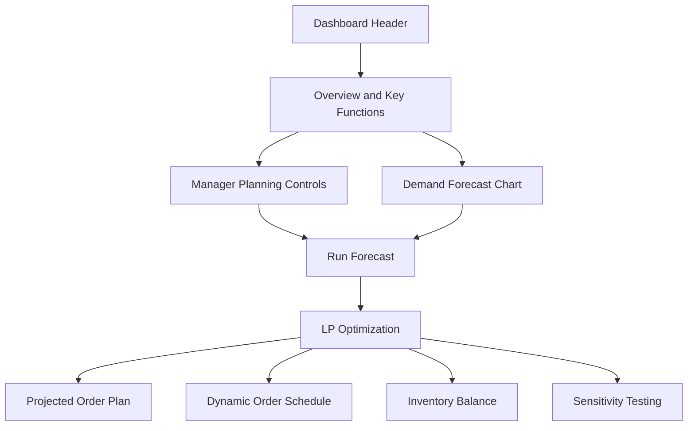

# Amazing Coffee Forecasting and Inventory Planning

## 1. Project Overview

This project develops an interactive demand forecasting and ingredient ordering dashboard for Amazing Coffee. The system supports three products:

- Cappuccino
- Latte
- Mocha

It converts beverage demand into ingredient requirements and uses a linear programming model to determine a cost-efficient order plan.

## 2. Project Objectives

The project aims to:

- Forecast demand for the following week.
- Convert product demand into ingredient requirements.
- Determine whether to order in each candidate order window.
- Determine the order quantity selected by the LP model.
- Minimize ingredient purchase cost and inventory holding cost.
- Present demand, orders, inventory, and sensitivity results in one dashboard.

## 3. Source Data and Business Assumptions

The prototype is based on historical demand patterns and the project assumptions.

- Products: Cappuccino, Latte, and Mocha.
- Ingredients: Coffee Bean, Milk Foam, Steamed Milk, and Chocolate Powder.
- Demand follows weekday patterns.
- There is no opening inventory before Monday.
- Monday, Thursday, and Saturday are candidate order windows.
- The LP model decides whether to order and how much to order in each candidate window.
- Thursday has a supplier discount.
- Inventory cannot become negative.
- Weekly total cost equals ingredient order cost plus inventory holding cost.

## 4. Page Structure

The page is organized as follows:



## 5. Main Functions

### Demand Forecast

The interface displays the expected demand of the three products for each weekday. Users can inspect the product-level demand pattern through the interactive chart.

### Manager Planning Controls

Managers can change the daily demand assumptions for Cappuccino, Latte, and Mocha. The updated inputs are used by the planning model.

### Run Forecast

The Run Forecast button applies the current demand and scenario inputs. It refreshes the LP result, projected order plan, order schedule, inventory balances, and cost summary.

### LP Order Planning

The LP model uses order quantities and ending inventory as decision variables. It minimizes:

$$
\text{Weekly Total Cost}
=
\text{Ingredient Order Cost}
+
\text{Inventory Holding Cost}
$$

The model determines:

- Whether an order is placed on Monday, Thursday, or Saturday.
- The quantity ordered on each selected day.
- The inventory remaining after daily consumption.
- The total purchase and holding cost.

### Projected Order Plan

The projected order plan presents:

- Required ingredient quantity.
- LP-selected order day or days.
- Effective unit cost.
- Total order quantity.

### Dynamic Order Schedule

The order schedule does not use permanently fixed weekday columns. It displays only the candidate order days selected by the LP solution. If a day is not selected by the LP model, it is not shown as an active order column.

### Inventory Balance

The inventory table allows the user to select a weekday and inspect:

- Opening inventory.
- Consumed quantity.
- Ending inventory.
- Daily holding cost.

### Sensitivity Testing

Users can change:

- Supplier discount.
- Holding cost multiplier.
- Demand change percentage.

The model then recalculates the cost and ordering result under the selected scenario.

## 6. Technical Implementation

### Static Web Version

- `index.html`: page structure and dashboard content.
- `styles.css`: layout, colors, tables, responsive styling, and visual design.
- `script.js`: forecast rendering, order calculations, inventory balances, and sensitivity logic.

### Streamlit Version

- `streamlit_app.py`: interactive dashboard and LP model.
- `SciPy HiGHS`: linear programming solver.
- `Plotly`: demand forecast chart.
- `Pandas`: result tables.
- `requirements.txt`: deployment dependencies.

### Deployment Configuration

- `.streamlit/config.toml`: Streamlit theme and server settings.
- `.gitignore`: excludes virtual environments and local files.
- `runtime.txt` and `.python-version`: Python runtime configuration.
- `GITHUB_DEPLOYMENT.md`: GitHub and Streamlit Cloud deployment instructions.

## 7. Agent Collaboration

The Agent was used as a programming and analysis assistant throughout the project. The collaboration can be summarized in four activities:

1. Interpret the project overview and source data.
2. Translate the business assumptions into forecasting, inventory, and LP logic.
3. Implement and refine the dashboard and Streamlit version.
4. Validate the calculation, prepare deployment files, and upload the project to GitHub.

The Agent helped identify inconsistencies between demand requirements, order quantities, holding cost, inventory balances, and displayed totals. The final implementation uses a unified flow:

```text
Demand inputs -> Ingredient demand -> LP order plan -> Inventory balance -> Cost summary
```

## 8. Validation

The project was checked through:

- Python syntax compilation.
- Local Streamlit startup.
- LP baseline calculation.
- Order cost plus holding cost reconciliation.
- Dynamic order-day column verification.
- GitHub repository and branch verification.

The baseline LP result currently reconciles as:

- Ingredient order cost: `$1,055.67`
- Holding cost: `$68.09`
- Weekly total cost: `$1,123.76`

## 9. Deployment

The project is stored in the following GitHub repository:

[SCM6111-demo](https://github.com/xiaoxiaohe-data-science/SCM6111-demo)

For Streamlit Community Cloud:

1. Select the repository `xiaoxiaohe-data-science/SCM6111-demo`.
2. Select branch `main`.
3. Set the main file to `streamlit_app.py`.
4. Deploy the application.

## 10. Limitations and Future Development

The current version is a teaching and demonstration prototype. Possible future improvements include:

- Fixed ordering cost.
- Minimum order quantity.
- Supplier lead time.
- Safety stock.
- Integer or mixed-integer order constraints.
- Excel Solver comparison.
- Data upload and download functions.
- User access control.
